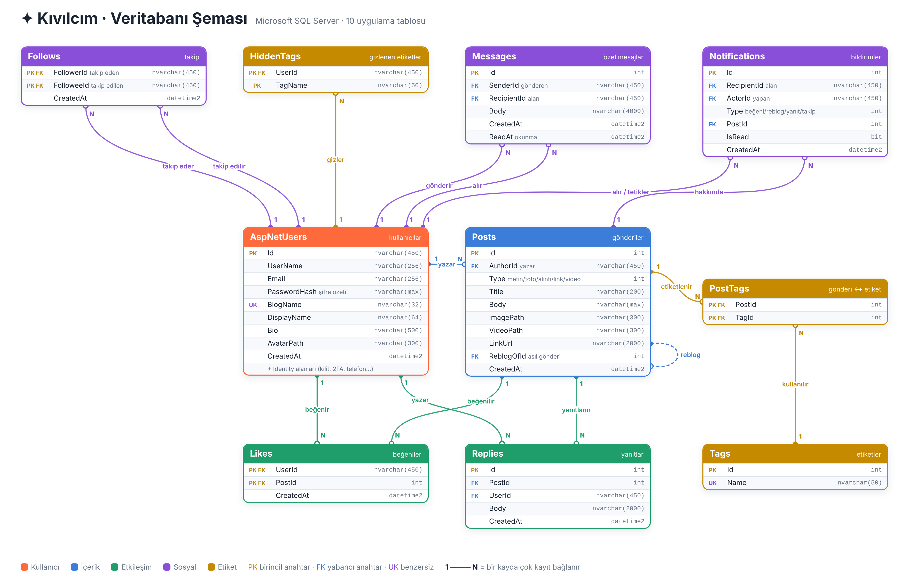

# Kıvılcım

Tumblr benzeri bir blog ve paylaşım platformu. ASP.NET Core 8 MVC, Entity Framework Core ve **Microsoft SQL Server** ile yazıldı.

## Özellikler

| Özellik | Açıklama |
|---|---|
| Hesap | Kayıt, giriş, şifre işlemleri (ASP.NET Core Identity). Kayıtta blog adı otomatik oluşur. |
| Gönderi türleri | Metin, **çoklu fotoğraf** (en fazla 30; cihazdan ya da internetten), video (MP4/WEBM, 50 MB), alıntı, bağlantı |
| Gönderi menüsü | "+ Gönderi" ile tür seçimi; telefonda alttan açılan panel ve sabit + düğmesi |
| Akış | Takip ettiğin blogların ve kendi gönderilerin, "Daha fazla göster" ile sayfalı |
| Keşfet | Son 30 günün en çok beğenilen ve yeniden paylaşılan gönderileri |
| Etiketler ve arama | `/tagged/{etiket}`, `/search?q=...`, popüler etiketler |
| Etkileşim | Beğeni (sayfa yenilenmeden), yeniden paylaşma (reblog, yorumlu), yanıt, notlar |
| Bloglar | `/blog/{ad}` sayfası, takip et / bırak, takipçi sayıları |
| Bildirimler | Beğeni, reblog, yanıt ve takipte SignalR ile anında bildirim; `/notifications` |
| Mesajlaşma | Kullanıcılar arası özel mesaj, anlık iletim; `/messages` |
| Ayarlar | Profil fotoğrafı, blog adı, görünen ad, hakkımda, gizlenen etiketler |
| Hesap | Türkçe giriş, kayıt, şifremi unuttum (e-posta ile sıfırlama), şifre değiştirme ve hesap silme |
| Güvenlik | CSRF koruması, HTML kaçışı, görsel türü ve imza kontrolü, sahiplik kontrolü |

## Kendi bilgisayarında çalıştırma (Windows + Visual Studio)

1. **Gerekenler:** Visual Studio 2022 ("ASP.NET and web development" iş yükü) ve .NET 8 SDK. SQL Server LocalDB, Visual Studio ile birlikte gelir.
2. Depoyu klonla ve `kivilcim` dalına geç, ardından `Kivilcim/Kivilcim.csproj` dosyasını aç.
3. **F5** ile çalıştır. İlk açılışta veritabanı migration'larla otomatik oluşturulur ve geliştirme ortamında örnek veriler eklenir.

Varsayılan bağlantı dizesi (`appsettings.json`):

```
Server=(localdb)\mssqllocaldb;Database=Kivilcim;Trusted_Connection=True;MultipleActiveResultSets=true;TrustServerCertificate=True
```

SQL Server Express ya da tam SQL Server kullanıyorsan yalnızca bu satırı değiştir, örneğin:

```
Server=.\SQLEXPRESS;Database=Kivilcim;Trusted_Connection=True;TrustServerCertificate=True
```

### Örnek hesaplar (yalnızca geliştirme ortamında)

| E-posta | Şifre | Blog |
|---|---|---|
| ayse@ornek.com | Demo1234 | /blog/ayse |
| mehmet@ornek.com | Demo1234 | /blog/mehmet-yazar |
| zeynep@ornek.com | Demo1234 | /blog/zeynep-kodluyor |

## E-posta (SMTP) ayarı: "Şifremi unuttum" için

`appsettings.json` içindeki `Email` bölümü doldurulursa sıfırlama e-postaları gerçekten gönderilir.
`Host` boş bırakılırsa e-postalar `App_Data/mail` klasörüne `.eml` dosyası olarak kaydedilir; geliştirirken bu dosyayı açıp bağlantıya tıklayabilirsin.

Gmail örneği (Google hesabında 2 adımlı doğrulama açık olmalı ve bir **uygulama şifresi** oluşturulmalı):

```json
"Email": {
  "Host": "smtp.gmail.com",
  "Port": 587,
  "EnableSsl": true,
  "UserName": "adresin@gmail.com",
  "Password": "uygulama-sifresi",
  "From": "adresin@gmail.com",
  "FromName": "Kıvılcım"
}
```

Şifreyi `appsettings.json` içine yazmak yerine Visual Studio'da projeye sağ tıklayıp **Manage User Secrets** ile saklamak daha güvenlidir.
Outlook/Hotmail için `smtp-mail.outlook.com`, port 587 kullanılır.

## Komut satırından

```bash
cd Kivilcim
dotnet run
```

Veritabanı modelini değiştirirsen yeni migration ekle:

```bash
dotnet tool install --global dotnet-ef --version 8.0.*
dotnet ef migrations add DegisiklikAdi -o Data/Migrations
```

## Docker ile yayınlama (site + SQL Server)

Depo kökünde:

```bash
cp .env.example .env
docker compose up -d --build
```

Site `http://localhost:8080` adresinde açılır. `.env` içindeki `SA_PASSWORD` değerini mutlaka değiştir.
Görseller, videolar ve oturum anahtarları Docker volume'larında kalıcıdır.

Gerçek bir sunucuya (ör. bir VPS) aynı komutlarla kurulabilir. Alan adı ve HTTPS için önüne Nginx ya da Caddy konulmalıdır.
Azure App Service + Azure SQL kullanmak istersen `Kivilcim/Dockerfile` doğrudan kullanılabilir;
bağlantı dizesi `ConnectionStrings__DefaultConnection` ortam değişkeniyle verilir.

## Sürekli entegrasyon (CI)

`.github/workflows/kivilcim.yml`: `kivilcim` dalına her push'ta projeyi derler, yayın paketini oluşturur,
gerçek bir SQL Server 2022 konteyneriyle başlatıp ana sayfaları kontrol eder.

## Veritabanı şeması



Tabloların açıklaması: [docs/VERITABANI.md](docs/VERITABANI.md)

## Proje yapısı (soğan mimarisi)

| Proje | Katman | Bağımlı olduğu |
|---|---|---|
| `src/Core` | Ortak soyutlamalar (IRepository, IUnitOfWork, IQueryExecutor, IFileStorage, IRealtimeNotifier, Result) | hiçbiri |
| `src/Model` | Domain: tablolar (ApplicationUser, Post, Like, Message...) | Core |
| `src/Bll` | Uygulama: servis arayüzleri ve gerçeklemeleri, DTO'lar, kurallar | Core, Model |
| `src/Dal` | Altyapı: EF Core, repository ve Unit of Work, Identity, dosya kaydı, e-posta, migration'lar | Core, Model, Bll |
| `src/Web` | Sunum: MVC, SignalR, Razor, konuşma paneli | Bll; Dal yalnızca kayıt ve Identity için |

Çözüm dosyası: `Kivilcim.sln`. Visual Studio'da başlangıç projesi **Kivilcim** (Web) olmalı; F5 veritabanını oluşturur.

```
Kivilcim.sln
src/Core/        Abstractions, Results, Realtime
src/Model/       Entities.cs
src/Bll/         Abstractions, Dtos, Services, Rules, Media, Utilities
src/Dal/         Data (DbContext, Migrations, SeedData), Repositories, Storage, Email, Identity
src/Web/         Controllers, Views, Hubs, Realtime, Helpers, Models, wwwroot, Areas/Identity
```

## Notlar

- Yüklenen görseller `wwwroot/uploads` klasörüne kaydedilir. Canlı ortamda Azure Blob veya S3 gibi bir depolamaya taşımak önerilir.
- Test amaçlı SQLite ile de çalışır: `Database__Provider=Sqlite` ve `ConnectionStrings__DefaultConnection="Data Source=kivilcim.db"` ortam değişkenleri.
