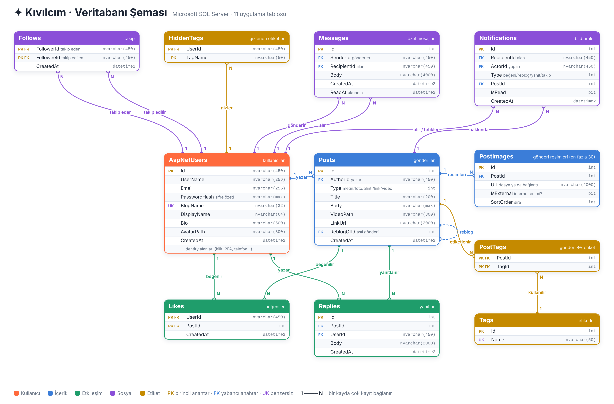
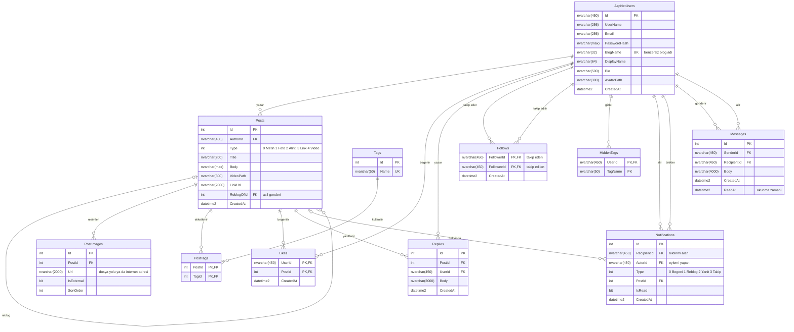

# Kıvılcım · Veritabanı Şeması

Kıvılcım, **Microsoft SQL Server** üzerinde **11 uygulama tablosu** kullanır. Bunlara ASP.NET Core Identity'nin kendi tabloları (roller, oturum açma bilgileri vb.) eklenir.

> Görselin etkileşimli hâli: [veritabani.html](veritabani.html) (indirip tarayıcıda açabilirsin).

## Şemayı Nasıl Okurum?

- **Her kutu bir tablo**, kutunun içindeki her satır **bir sütun**dur.
- **PK** (Primary Key, birincil anahtar) = Satırı benzersiz tanımlayan alan. Örnek: gönderinin numarası.
- **FK** (Foreign Key, yabancı anahtar) = Başka bir tablodaki satırı gösteren alan. Örnek: `Posts.AuthorId` → gönderiyi yazan kullanıcı.
- **UK** (Unique Key) = Aynı değer iki kez olamaz. Örnek: iki kullanıcı aynı **blog adını** alamaz.
- **1 ──── N** = Bir kayda **birden çok** kayıt bağlanır. Örnek: **bir** kullanıcının **çok** gönderisi olur.

## Tablolar

| Tablo | Ne saklar? | Anahtar |
|---|---|---|
| **AspNetUsers** | Kullanıcılar: e-posta, şifre özeti, blog adı, profil | `Id` |
| **Posts** | Gönderiler: tür, başlık, metin, video, bağlantı | `Id` |
| **PostImages** | Fotoğraf gönderisinin resimleri (en fazla 30); yüklenen dosya ya da internet bağlantısı | `Id` |
| **Tags** | Etiket adları (`kedi`, `yaz tatili`) | `Id` |
| **PostTags** | Hangi gönderide hangi etiket var | `PostId` + `TagId` |
| **Likes** | Kim hangi gönderiyi beğendi | `UserId` + `PostId` |
| **Replies** | Gönderilere yazılan yanıtlar | `Id` |
| **Follows** | Kim kimi takip ediyor | `FollowerId` + `FolloweeId` |
| **HiddenTags** | Kullanıcının akışında görmek istemediği etiketler | `UserId` + `TagName` |
| **Notifications** | Bildirimler: "X gönderini beğendi" | `Id` |
| **Messages** | Kullanıcılar arası özel mesajlar | `Id` |

## Önemli Noktalar

- **İki sütunlu anahtarlar:** `Likes` tablosunda anahtar `UserId + PostId`'dir.
  - **Bu şu demektir:** Bir kullanıcı aynı gönderiyi **iki kez beğenemez**; veritabanı buna izin vermez.
- **Reblog:** `Posts.ReblogOfId` yine `Posts` tablosunu gösterir (tablo kendine bağlanır).
  - Reblog'un reblog'u yapılsa bile **her zaman asıl gönderiye** bağlanır.
- **Çoklu resim:** Bir fotoğraf gönderisinin **birden çok** resmi olabilir; bu yüzden resimler ayrı **`PostImages`** tablosunda tutulur.
  - `IsExternal = 1` ise resim **internetten eklenmiş bir bağlantıdır**, sunucuya indirilmez.
  - `SortOrder` resimlerin gösterilme sırasıdır.
- **Çoka çok ilişki:** Bir gönderinin çok etiketi, bir etiketin çok gönderisi olabilir. Bu yüzden araya **`PostTags`** tablosu konuldu.
- **Silme kuralları:** SQL Server bir tabloya giden **birden fazla otomatik silme (cascade) yolunu** kabul etmez.
  - Bu yüzden kullanıcı silinirken beğenileri, yanıtları, takipleri, mesajları ve bildirimleri **uygulama kodu** temizler (`ApplicationDbContext.SaveChangesAsync`).
- **Tür alanları (`Type`) sayı olarak saklanır:**
  - `Posts.Type`: 0 Metin · 1 Fotoğraf · 2 Alıntı · 3 Bağlantı · 4 Video
  - `Notifications.Type`: 0 Beğeni · 1 Reblog · 2 Yanıt · 3 Takip

## Migration'lar

| Migration | Ne ekledi? |
|---|---|
| `InitialCreate` | Kullanıcı, gönderi, etiket, beğeni, yanıt, takip, gizli etiket tabloları |
| `NotificationsMessagesVideo` | `Notifications` ve `Messages` tabloları, `Posts.VideoPath` sütunu |
| `PostImagesGallery` | `PostImages` tablosu; eski gönderilerin tek resmi bu tabloya taşındı, `Posts.ImagePath` kaldırıldı |

## Metin Olarak Şema (Mermaid)

GitHub bu bölümü otomatik olarak diyagrama çevirir.

